# 책추책책추

> 읽은 책과 관심 태그로 오늘의 한 권을 골라 주는 개인화 도서 추천 서비스

<p align="center">
  
</p>

<p align="center"><strong>추천받고, 기록하고, 기록이 모여 나의 독서 취향이 되는 곳</strong></p>

---

## 📌 목차

- [책추책책추](#책추책책추)
  - [📌 목차](#-목차)
  - [📚 서비스 소개](#-서비스-소개)
  - [💡 기획 배경](#-기획-배경)
  - [📋 프로젝트 개요](#-프로젝트-개요)
  - [👥 팀원 소개](#-팀원-소개)
  - [✨ 주요 기능](#-주요-기능)
    - [🎡 연령·성별 인기 도서 링](#-연령성별-인기-도서-링)
    - [💌 오늘의 책추](#-오늘의-책추)
    - [📖 나만의 책 한 권](#-나만의-책-한-권)
    - [🔖 내가 찜한 책](#-내가-찜한-책)
    - [🧬 BOOK DNA](#-book-dna)
    - [🎰 완전랜덤 책 가챠](#-완전랜덤-책-가챠)
    - [🏆 책 이상형 월드컵](#-책-이상형-월드컵)
  - [🛠 기술 스택](#-기술-스택)
  - [🏗 시스템 아키텍처](#-시스템-아키텍처)
  - [🗄 ERD](#-erd)
  - [📡 API 명세](#-api-명세)
  - [🔬 핵심 기술 상세](#-핵심-기술-상세)
    - [도서 데이터 수집·전처리](#도서-데이터-수집전처리)
    - [임베딩 기반 벡터 추천](#임베딩-기반-벡터-추천)
    - [다시 추천받기와 중복 제외](#다시-추천받기와-중복-제외)
    - [BOOK DNA 산출 방식](#book-dna-산출-방식)
    - [오프라인 LLM 배치](#오프라인-llm-배치)
    - [Elasticsearch 도서 검색](#elasticsearch-도서-검색)
    - [PixiJS 인기 도서 링과 프론트엔드 최적화](#pixijs-인기-도서-링과-프론트엔드-최적화)
    - [인증 및 연결 보안](#인증-및-연결-보안)
    - [CI/CD와 배포](#cicd와-배포)
  - [📝 회고](#-회고)

## 📚 서비스 소개

**책추책책추**는 사용자가 읽은 책과 관심 태그를 바탕으로 오늘 읽을 책을 한 권씩 골라 주는 개인화 도서 추천 서비스입니다.

추천받은 책은 `읽었어요` · `읽고 싶어요`로 내 서재에 담고, 별점과 짧은 기록을 남길 수 있습니다. 쌓인 기록은 **BOOK DNA**로 분석되어 나의 독서 타입과 취향의 지도, 독서 습관 리포트로 돌아옵니다.

## 💡 기획 배경

**텍스트힙(Text Hip)**, 즉 독서를 멋진 활동으로 여기는 흐름 속에서 20대 종합독서율은 **75.3%** 로 전 연령대 중 가장 높습니다. *(문화체육관광부, 2025년 국민독서실태조사)*

하지만 **"이 많은 책들 중에서 어떤 책을 읽어야 하지?"** 라는 질문 앞에서는 여전히 베스트셀러 목록, SNS 추천, 알고리즘이 띄워 주는 책에 기대게 됩니다. 책추책책추는 남이 많이 읽은 책이 아니라 **내가 읽어 온 책**에서 출발해 다음 한 권을 고르는 경험을 목표로 합니다.

## 📋 프로젝트 개요

| 항목 | 내용 |
| --- | --- |
| 프로젝트명 | 책추책책추 |
| 프로젝트 유형 | 개인화 도서 추천 서비스 |
| 개발 기간 | `2026.08.18 ~ 2026.10.02` |
| 개발 인원 | 6명 |
| 플랫폼 | Web Application |
| 배포 환경 | AWS EC2 (Ubuntu 24.04) · Docker Compose · Jenkins |

## 👥 팀원 소개

<table>
  <tr>
    <td align="center" valign="top" width="300" height="320">
      <br />
      <strong>이가영</strong><br />팀장 · FE<br />
      <a href="https://github.com/rkdud000">@rkdud000</a><br /><br />
      UI/UX 디자인·디자인 시스템<br />주요 페이지 구현·프론트엔드 성능 개선
    </td>
    <td align="center" valign="top" width="300" height="320">
      <br />
      <strong>장민식</strong><br />FE<br />
      <a href="https://github.com/msik-j">@msik-j</a><br /><br />
      도서 검색·독서 기록 화면 구현<br />추천·BOOK DNA API 연동
    </td>
    <td align="center" valign="top" width="300" height="320">
      <br />
      <strong>홍유라</strong><br />FE<br />
      <br />
      UI/UX 디자인<br />홈·내 서재 화면 구현·도서 데이터 수집
    </td>
  </tr>
  <tr>
    <td align="center" valign="top" width="300" height="320">
      <br />
      <strong>양금규</strong><br />BE · DATA<br />
      <br />
      도서 데이터 수집·적재 파이프라인<br />도서·인증 API 구현
    </td>
    <td align="center" valign="top" width="300" height="320">
      <br />
      <strong>조성진</strong><br />BE · INFRA<br />
      <a href="https://github.com/jinkong9">@jinkong9</a><br /><br />
      도서 검색·서재 API 구현<br />CI/CD·배포 인프라 구축
    </td>
    <td align="center" valign="top" width="300" height="320">
      <br />
      <strong>이어진</strong><br />AI · 발표<br />
      <a href="https://github.com/win929">@win929</a><br /><br />
      AI 도서 추천 엔진 구현<br />BOOK DNA 분석·LLM 태깅
    </td>
  </tr>
</table>

## ✨ 주요 기능

### 🎡 연령·성별 인기 도서 링

> 홈 화면에서 10대부터 60대 이상까지 연령 × 성별 그룹이 많이 빌린 책을 원형 링으로 보여 줍니다. 링을 드래그해 돌리고, 그룹을 고르면 해당 세그먼트의 인기 도서 20권을 Ring view와 Grid view로 살펴볼 수 있습니다.

| 인기 도서 링 화면 | 인기 도서 링 GIF |
| --- | --- |
| 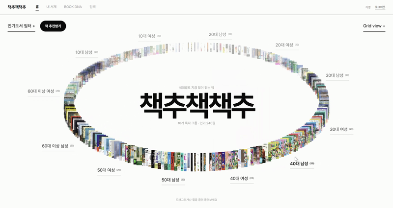 | 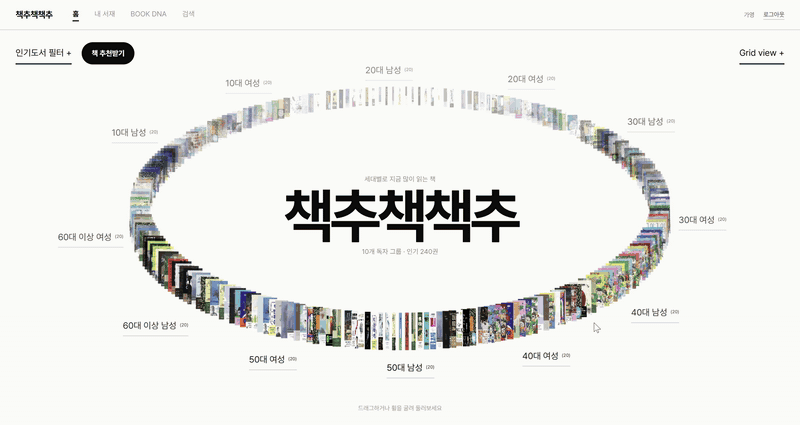 |

### 💌 오늘의 책추

> 읽은 책과 관심 태그를 바탕으로 오늘의 책을 엽서와 함께 건넵니다. 추천 이유를 엽서에 적어 주고, 책 상세에서는 비슷한 책과 함께 대출된 책을 이어서 보여 줍니다. `다시 추천받기`로 새 추천을, `관심 태그 고르기`로 추천 기준을 바꿀 수 있습니다.

| 오늘의 책추 화면 | 추천 흐름 GIF |
| --- | --- |
| 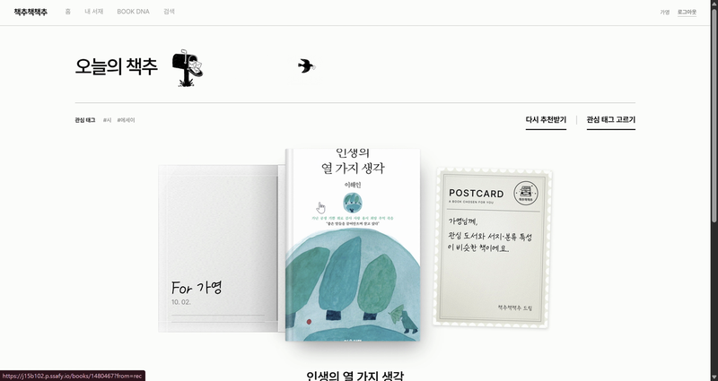 | 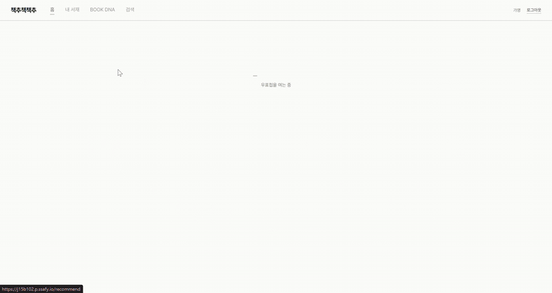 |

### 📖 나만의 책 한 권

> 다 읽은 책은 한 권의 양장본처럼 넘겨 보는 독서 아카이브에 모입니다. 목차와 해별 완독 연표로 기록을 찾아가고, `독서 기록 수정`에서 완독일·별점·최대 300자 감상평을 고칠 수 있습니다.

| 나만의 책 한 권 화면 | 아카이빙 GIF |
| --- | --- |
| 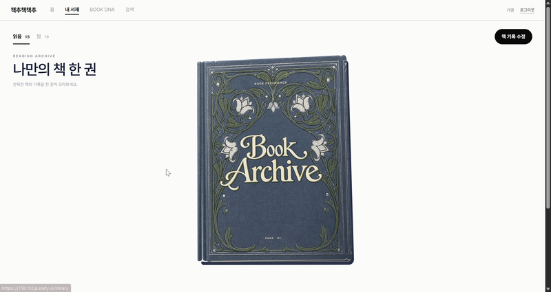 | 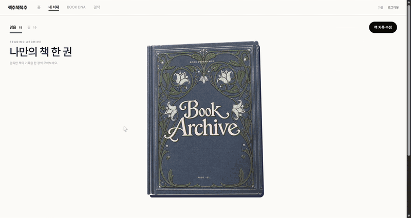 |

### 🔖 내가 찜한 책

> `읽고 싶어요`로 담은 책은 장르별 책장에 꽂혀 한눈에 보입니다.

| 내가 찜한 책 화면 | 찜한 책 GIF |
| --- | --- |
| 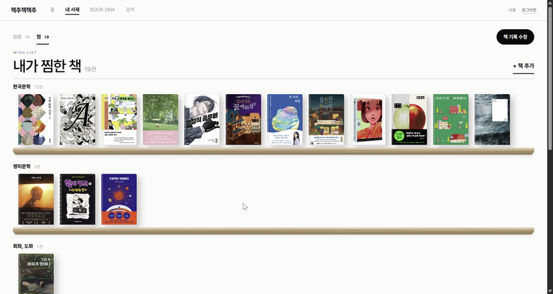 | 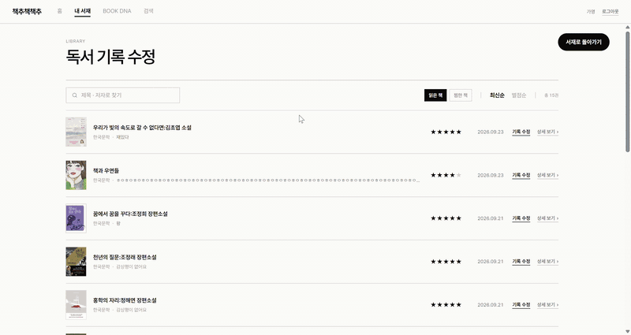 |

### 🧬 BOOK DNA

> 읽은 책이 모여 당신의 취향이 됩니다. 독서 기록을 몰입·감성·새로움·현실감·사색 5가지 지표로 분석해 `감성 탐독가` 같은 독서 타입을 붙여 주고, 6축 장르 레이더로 그린 취향의 지도와 독서 습관 리포트를 함께 보여 줍니다.

| BOOK DNA 화면 | 취향 분석 GIF |
| --- | --- |
| 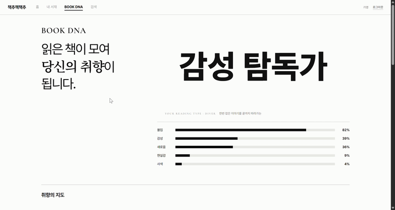 | 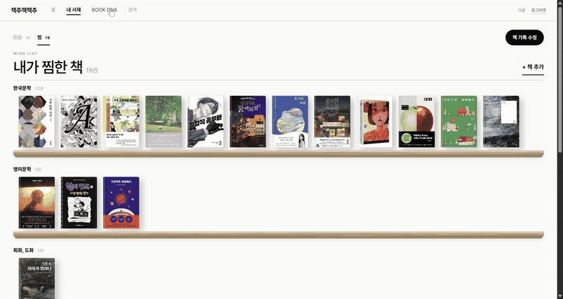 |

### 🎰 완전랜덤 책 가챠

> 뽑기 기계의 손잡이를 돌리면 추천 후보 중 한 권이 무작위로 나옵니다. 마음에 들면 바로 서재에 담을 수 있습니다.

| 책 가챠 화면 | 책 가챠 GIF |
| --- | --- |
| 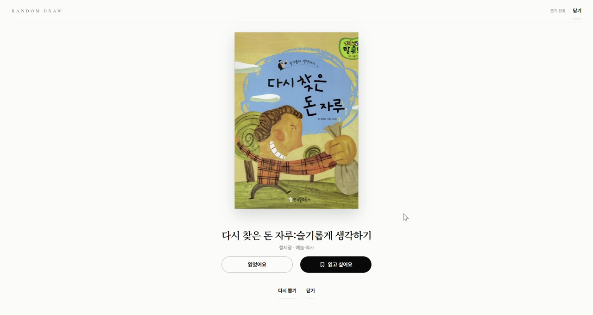 | 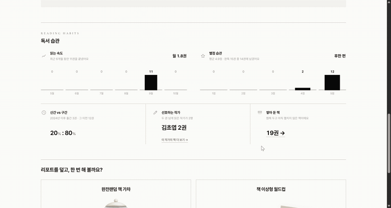 |

### 🏆 책 이상형 월드컵

> 제목·저자·표지를 가리고 AI가 쓴 소개글만 보고 고르는 16강 월드컵입니다. 선입견 없이 끌리는 이야기를 고르다 보면 마지막에 우승한 책 한 권만 공개됩니다.

| 이상형 월드컵 화면 | 이상형 월드컵 GIF |
| --- | --- |
| 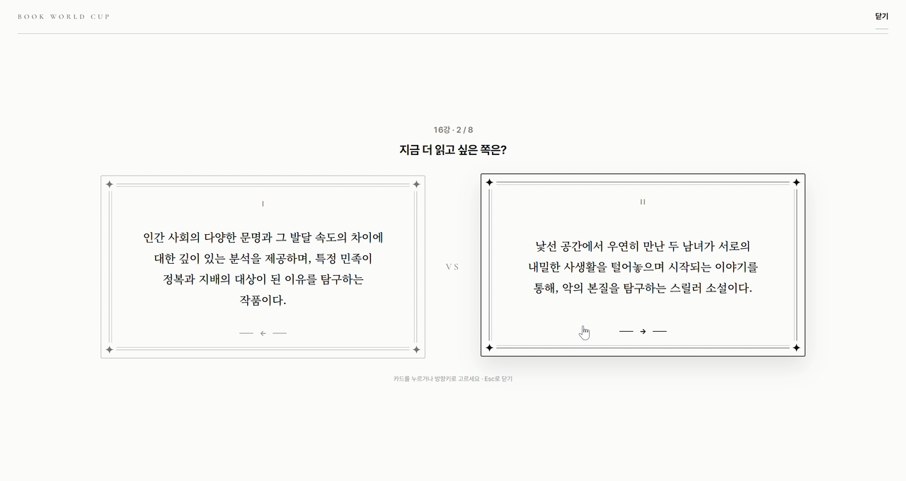 | 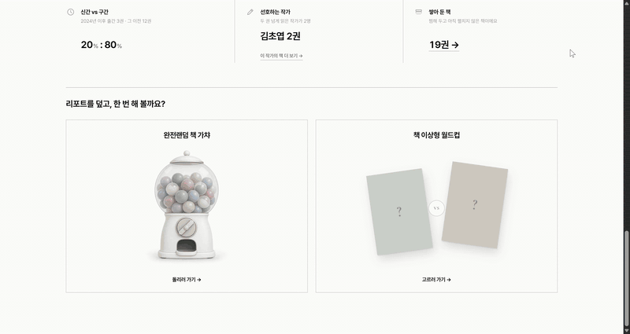 |

## 🛠 기술 스택

| 분류 | 기술 |
| --- | --- |
| **Frontend** |           |
| **Backend** |         |
| **AI · 추천** |     |
| **Database · Search** |    |
| **Data Pipeline** |     |
| **Infrastructure** |       |

## 🏗 시스템 아키텍처

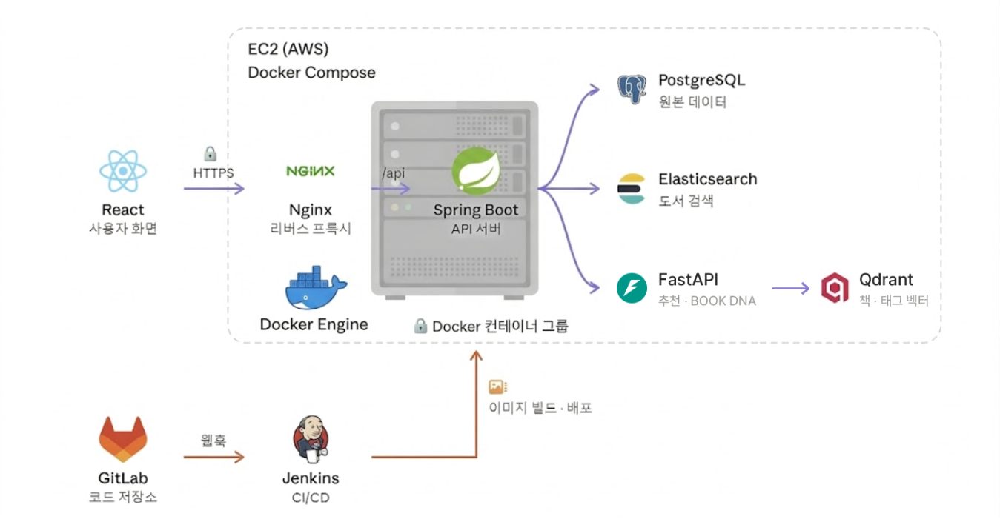

- **Frontend**: React + TypeScript + Vite SPA. Nginx가 정적 파일을 서빙하고 HTTPS(Let's Encrypt)를 종료
- **Reverse Proxy**: Nginx가 `/api`·`/swagger-ui`를 Spring Boot로, `/covers/naver/`를 네이버 표지 CDN으로(호스트 고정, 30일 캐시) 넘기고 나머지는 SPA로 폴백
- **API Server**: Spring Boot가 인증·서재·검색·추천·BOOK DNA 흐름을 담당
- **PostgreSQL 16**: 원천 저장소. 회원·서재·도서 331만 권·추천 스냅샷
- **Elasticsearch 8.19 + nori**: PostgreSQL에서 만든 검색 읽기 모델(alias `books`)
- **FastAPI + Qdrant 1.18**: 책·태그 벡터 검색 기반 추천과 BOOK DNA 계산(alias `books_active`)
- **오프라인 배치**: 데이터 파이프라인(Python·DuckDB) → PostgreSQL 적재, AI CLI(GMS 임베딩·태깅·소개문) → Qdrant·PostgreSQL
- **CI/CD**: GitLab Webhook → Jenkins → EC2 Docker Compose 배포. 외부 포트는 80/443만 열고 DB·검색·벡터 저장소는 `127.0.0.1`에만 바인딩

## 🗄 ERD

- [ERDCloud에서 보기](https://www.erdcloud.com/d/wLbJQcMzYJL3offMX)

```mermaid
erDiagram
    USERS ||--o{ USER_INTERESTS : chooses
    TAGS ||--o{ USER_INTERESTS : chosen
    USERS ||--o{ REFRESH_TOKENS : sessions
    USERS ||--o{ USER_LIBRARY : owns
    BOOKS ||--o{ USER_LIBRARY : saved_in
    USERS ||--o{ RECOMMENDATIONS : receives
    RECOMMENDATIONS ||--o{ RECOMMENDATION_ITEMS : contains
    BOOKS ||--o{ RECOMMENDATION_ITEMS : recommended
    USERS ||--o{ USER_ACTIONS : acts
    RECOMMENDATIONS o|--o{ USER_ACTIONS : measured
    BOOKS o|--o{ USER_ACTIONS : about
    USERS ||--o| USER_DNA_PROFILES : analyzed
    USERS ||--o{ BOOK_WORLD_CUP_SESSIONS : plays
    BOOKS ||--o| BOOK_WORLD_CUP_SYNOPSES : summarized
    KDC_CODES ||--o{ KDC_CODES : parent
    BOOKS ||--o{ BOOK_TAGS : tagged
    TAGS ||--o{ BOOK_TAGS : tags
    BOOKS ||--o{ BOOK_KEYWORDS : has
    BOOKS ||--o{ BOOK_RELATIONS : co_loan
    BOOKS ||--o{ BOOK_DEMAND_FEATURES : monthly
    BOOKS ||--o{ BOOK_LOANED_TOP20 : ranked

    USERS {
        bigint id PK
        varchar oauth_provider
        varchar oauth_subject
        varchar nickname
        smallint birth_year
        char gender
        varchar onboarding_status
    }
    BOOKS {
        bigint id PK
        char isbn13 UK
        varchar title
        varchar author
        varchar publisher
        smallint pub_year
        varchar category_code
        text description
        varchar cover_url
        boolean is_searchable
        boolean is_candidate
    }
    USER_LIBRARY {
        bigint id PK
        bigint user_id FK
        bigint book_id FK
        varchar status
        smallint rating
        varchar review_text
        date finished_at
    }
    RECOMMENDATIONS {
        bigint id PK
        bigint user_id FK
        varchar mode
        boolean fallback
        jsonb weights
        jsonb input_tags
    }
    RECOMMENDATION_ITEMS {
        bigint id PK
        bigint recommendation_id FK
        bigint book_id FK
        smallint rank
        numeric score
        jsonb feature_scores
        varchar reason_type
    }
    USER_ACTIONS {
        bigint id PK
        bigint user_id FK
        bigint book_id FK
        bigint recommendation_id FK
        varchar event_type
        varchar client_event_id
    }
    REFRESH_TOKENS {
        bigint id PK
        bigint user_id FK
        uuid family_id
        char token_hash
        timestamptz expires_at
        timestamptz rotated_at
        timestamptz revoked_at
    }
    USER_DNA_PROFILES {
        bigint user_id PK
        varchar library_fingerprint
        jsonb profile
        timestamptz generated_at
    }
    BOOK_WORLD_CUP_SESSIONS {
        uuid session_id PK
        bigint user_id FK
        varchar status
        smallint round_size
        jsonb round_participants
        char champion_isbn13
        timestamptz expires_at
    }
    BOOK_RELATIONS {
        bigint id PK
        bigint source_book_id FK
        bigint target_book_id FK
        varchar relation_type
        smallint rank
    }
    BOOK_DEMAND_FEATURES {
        bigint book_id PK
        char as_of_month PK
        bigint loan_cum
        numeric trending_score
        numeric steady_score
    }
```

| 도메인 | 주요 테이블 | 설명 |
| --- | --- | --- |
| 인증·사용자 | `users`, `refresh_tokens`, `user_interests`, `tags` | OAuth 계정, 리프레시 토큰 계열, 관심 태그 |
| 도서 | `books`, `kdc_codes`, `book_tags`, `book_keywords` | 도서 카탈로그와 분류·태그·키워드 |
| 추천 신호 | `book_relations`, `book_demand_features`, `book_loaned_top20` | 함께 대출 관계, 월별 대출 수요, 연령·성별 인기 |
| 서재·행동 | `user_library`, `user_actions` | 읽음·찜 기록, 노출·클릭 등 행동 이벤트 |
| 추천 | `recommendations`, `recommendation_items` | 추천 덱 스냅샷과 항목별 근거 |
| BOOK DNA | `user_dna_profiles`, `book_world_cup_synopses`, `book_world_cup_sessions` | DNA 캐시, 월드컵 소개문·대진 |

스키마는 Flyway `V1 ~ V12`로 관리했습니다. 적용된 마이그레이션은 수정하지 않고, Flyway는 스키마만 만들며 대용량 데이터는 파이프라인이 적재합니다.

## 📡 API 명세

모든 엔드포인트는 `/api/v1` 아래에 있으며, Swagger UI(`/swagger-ui.html`)로 확인할 수 있습니다.

| 영역 | 대표 기능 |
| --- | --- |
| 인증 | OAuth 로그인(카카오·Google), 토큰 갱신, 로그아웃 |
| 사용자 | 내 정보, 온보딩 프로필·관심 태그 저장, BOOK DNA 조회 |
| 도서 | 검색(KDC 필터), 인기·세그먼트 인기, 상세, 비슷한 책, 함께 대출된 책, 랜덤 |
| 추천 | 오늘의 추천, 같은 취향으로 다음 덱 |
| 서재 | 서재 조회, 담기, 상태·별점·감상평 수정, 삭제 |
| 이벤트 | 노출·찜·닫기 등 행동 이벤트 수집 |
| 월드컵 | 세션 생성, 선택 제출, 우승 결과 |

## 🔬 핵심 기술 상세

### 도서 데이터 수집·전처리

국립중앙도서관 서지와 도서관 정보나루 장서·대출 원장을 합쳐 서비스 카탈로그를 만들고, 검색과 추천에 쓸 책을 층으로 나눴습니다.

| 단계 | 규모 | 내용 |
| :-- | --: | :-- |
| 국립중앙도서관 서지 | 2,047,239행 | ISBN 서지 API, 발행예정일 구간을 쪼개 받는 적응형 수집 |
| 정보나루 장서·대출 원장 | 1,660개관 · 1.42억 행 | 2,953,587종, 누적 대출 19.7억 건 |
| 서비스 카탈로그 (`books`) | 3,312,467권 | 원장 도서 ∪ 국립중앙도서관에만 있는 책 − 체크섬 불량 ISBN |
| 검색 노출 (`is_searchable`) | 976,246권 | 소장 0관 · 수험서 · 전자책 · 교과서 제외 |
| 추천 후보 (`is_candidate`) | 406,451권 | 누적 대출 커버리지 90% + 2025년 이후 신간, 신호 없는 책 제외 |

| 핵심 구현 | 적용 내용 |
| :-- | :-- |
| 한도 실측 기반 수집 | 정보나루 API를 키당 하루 29,000건 예산으로 운용하고, 502/503/504·타임아웃이 30회 연속이면 모든 워커를 멈췄다가 5분마다 재확인 |
| 이어받기·내구성 | 락 파일, 주기적 fsync, 출력 파일 기반 재개, KST 자정 쿼터 초기화에 맞춘 자동 재개, EC2 systemd 상주 |
| ISBN 정규화 | 모든 컬럼을 문자열로 다뤄 `979` 접두와 선행 0을 보호하고, ISBN 10→13 변환을 DuckDB SQL 매크로로 처리, 체크섬으로 자리표시 값 제거 |
| 소스 병합 | 원장 최빈 서지 → 정보나루 → 국립중앙도서관 → 카카오 순. KDC는 1,660관의 최빈값 |
| 결측 처리 | 0이나 빈 문자열로 채우지 않고 NULL과 사유를 남김. 1970-01-01 자리표시 등록일 제거 |
| DB 제약 | `CHECK (NOT is_candidate OR is_searchable)`로 추천 후보는 반드시 검색 대상이도록 강제 |

### 임베딩 기반 벡터 추천

책의 서지 6필드(`bookname · authors · publisher · pub_year · class_no · class_nm`)와 관심 태그를 같은 임베딩 모델(`text-embedding-3-small`, 1536차원, GMS)로 벡터화해 Qdrant에 저장했습니다. 대출 관계는 임베딩 텍스트에 넣지 않고 payload와 재정렬 신호로만 사용합니다.

```text
읽은 책(별점 있는 최근 READ 최대 20권) + 관심 태그
  → seed 벡터 평균과 태그 prototype 벡터를 semantic : tagMatch 가중치로 결합
  → 의미 검색 leg + 태그 필터 leg를 RRF(k=60)로 융합해 100~300개 후보 풀
  → 서재·seed·비활성 도서 하드 필터
  → 5개 신호 가중 재정렬 (결측 신호는 0점이 아니라 분모에서 제외)
  → 같은 저자 −12점 · 같은 작품 −15점 다양성 보정 → 상위 5권
```

| 신호 | semantic | tagMatch | coLoan | trending | steady |
| :-- | :-: | :-: | :-: | :-: | :-: |
| 기본 가중치 | 0.45 | 0.25 | 0.15 | 0.10 | 0.05 |

- **추천 근거**: 기여도 순서로 고르는 결정적 템플릿 5종(TAG_MATCH, SEMANTIC, CO_LOAN, TRENDING, STEADY). LLM 문장을 쓰지 않음
- **비슷한 책**: 같은 추천 API에 기준 책 1권을 seed로, semantic 가중치만 두고 호출
- **콜드 스타트**: 읽은 책도 태그도 없으면 백엔드가 연령 × 성별 세그먼트 인기 도서로 응답
- **무중단 인덱스 교체**: 컬렉션을 `prefix_{sha256(indexVersion)[:16]}`로 만들고, 적재 실패가 하나도 없을 때만 `books_active` alias를 원자 교체

### 다시 추천받기와 중복 제외

처음 추천에서는 서재에 있는 책을 빼고 가장 가까운 5권을 고릅니다. 다시 추천받으면 서버가 상태를 따로 들지 않고 **최근 덱 3개**를 제외 목록으로 넘겨 다음 5권을 고르며, 후보가 모자라면 오래된 덱부터 제외를 풉니다. AI 서버가 폴백을 돌려주면 세그먼트 인기 도서로 대체합니다.

### BOOK DNA 산출 방식

| 단계 | 적용 내용 |
| :-- | :-- |
| ① 기록에 무게 | 가중치 = 상태(READ 1.0 · WISH 0.25) × 별점(1점 0.7 ~ 5점 1.5) × 최신성(완독일 기준 반감기 180일), 최대 200권 |
| ② 장르 비율 | 장르 태그로 6개 축(소설·에세이·인문사회·경제경영·과학기술·예술역사)에 배분하고, 태그가 없으면 KDC 접두로 대체 |
| ③ 5가지 지표 | 장르 비율을 조합해 몰입 · 감성 · 새로움(장르 엔트로피) · 현실감 · 사색 점수 계산 |
| ④ 독서 타입 | 2위 지표 + 1위 지표의 이름 (예: 감성 + 몰입 → `감성 탐독가`) |

백엔드는 AI에 보낸 서재 지문(sha256)으로 결과를 24시간 캐시하고, AI 서버 장애 시에는 마지막으로 저장된 프로필을 돌려줍니다.

### 오프라인 LLM 배치

요청을 처리하는 동안에는 LLM과 임베딩을 한 번도 부르지 않고, 모든 모델 호출을 오프라인 배치로 분리했습니다.

| 배치 | 적용 내용 |
| :-- | :-- |
| 태그 생성 | KDC·대출 패턴 규칙 태거를 먼저 돌려 신뢰도 0.85 이상이면 LLM 생략, 나머지만 16권씩 묶어 `gpt-4o-mini`에 요청. 허용 코드 밖 결과는 버리고 실패 시 단건 → 규칙 태그로 폴백 |
| 태그만 갱신 | 태그는 임베딩 입력이 아니므로 분류 체계를 넓혀도 재임베딩 없이 Qdrant payload만 갱신 |
| 월드컵 소개문 | 대출 상위 판본을 중복 제거해 고른 책에 대해, 제목·저자·출판사를 뺀 입력으로 `gpt-4o-mini`(temperature 0) 생성. 360자·2문장 이하, 스포일러 정규식, 제목·저자 노출 여부를 코드로 검증하고 2회 재시도 후 폐기 |

### Elasticsearch 도서 검색

| 핵심 구현 | 적용 내용 |
| :-- | :-- |
| 무중단 재색인 | 물리 인덱스 이름을 매핑 버전(`books_v1` ~ `books_v7`)으로 두고 코드는 alias `books`로만 접근. 새 인덱스 문서 수가 PostgreSQL과 같을 때만 alias를 옮기고 옛 인덱스는 롤백용으로 보존 |
| 분석기 | nori(`decompound_mode: mixed`) + 2-gram, 띄어쓰기 무시 정규화 |
| 랭킹 | `cross_fields`(title^3, authors^2, publisher) + 완전 일치 ×10, 표지 없는 책 ×0.7, 동점은 누적 대출순 |
| 매핑 개선 | 한자 독음 필터 제거(`秋天`이 '추천'으로 검색되던 문제), 표지 가중, 권차, 검색 노출 층 반영 |

### PixiJS 인기 도서 링과 프론트엔드 최적화

| 기술 | 선택 및 활용 이유 |
| :-- | :-- |
| PixiJS | 표지 수백 장을 타원 링으로 배치하고 드래그 회전·관성·자동 회전을 WebGL로 그리기 위해 사용 |
| TanStack Query | 서버 상태 캐시와 재시도 관리(`retry: 1`, `staleTime: 60s`) |
| Zustand | 인증·완독 모달·추천 조정 같은 클라이언트 상태를 가볍게 관리 |
| MSW | 백엔드보다 앞서 화면을 만들 수 있도록 개발 중 API 모킹(`VITE_ENABLE_MSW`일 때만 동작) |

| 핵심 구현 | 적용 내용 |
| :-- | :-- |
| 링 드래그 회전 | 커서를 링 위의 점으로 보고 타원을 원으로 정규화한 좌표계에서 지나간 각도만큼 회전해, 링 위·아래에서도 잡은 표지가 커서를 따라오게 함 |
| 데이터 폴백 | `GET /books/popular-segments`가 비었거나 실패하면 정적 스냅샷으로 폴백해 화면이 데이터 일정에 묶이지 않게 함 |
| 표지 CORS 해결 | WebGL 텍스처로 올릴 수 없는 네이버 표지를 Nginx 동일 출처 프록시(`/covers/naver/`, 호스트 고정·GET만)로 해결. 열린 프록시는 SSRF 통로라 배제 |
| URL 기반 대화상자 | 가챠·월드컵을 `/dna?play=gacha`처럼 URL에 두어 뒤로가기가 리포트를 떠나지 않고 대화상자만 닫도록 함 |
| 라우트 코드 분할 | 8개 페이지를 `React.lazy`로 분할해 첫 JS **581KB → 332KB** |
| 이미지 최적화 | 서재·카드 이미지 WebP 전환 **7.3MB → 743KB**, 랜딩 일러스트 **2.3MB → 282KB** |

### 인증 및 연결 보안

- 자체 가입 없이 카카오·Google OAuth 최초 로그인을 가입으로 처리하고, OAuth `state`는 HttpOnly 쿠키에 담아 상수 시간 비교
- 액세스 토큰은 메모리에만 두고, 401이면 single-flight로 한 번만 갱신한 뒤 재시도
- 리프레시 토큰은 32바이트 난수의 SHA-256 해시만 저장하고 갱신마다 회전. 절대 만료 14일, 회전 후 10초 유예(탭 두 개 경합 허용), 유예 밖 재사용이 감지되면 계열 전체 폐기
- 갱신 요청은 `Origin` 헤더를 검사해 CSRF를 막고, 만료 토큰은 매일 04:20에 정리
- 외부 포트는 80/443만 열고, `/actuator`·숨김 파일 경로는 Nginx에서 404 처리

### CI/CD와 배포

| 핵심 구현 | 적용 내용 |
| :-- | :-- |
| 변경 경로 기반 CI | Jenkins가 바뀐 경로로 돌릴 컴포넌트를 고르고, FE·AI·데이터·배포 검사는 병렬, BE는 CI 전용 PostgreSQL·Elasticsearch를 띄워 테스트 |
| 안전한 배포 | 배포 락 → 마이그레이션 지문 비교 → 지문이 바뀐 배포만 `pg_dump` 백업 → 빌드·기동 → 헬스체크 |
| 자동 복구 | 헬스체크 실패 시 마이그레이션 지문이 같을 때만 직전 릴리스로 자동 복구(Flyway는 전진 전용이므로) |
| 리소스 배분 | 16GiB EC2 한 대에 web 128m · backend 1.5g · ai 1g · PostgreSQL 3g · Elasticsearch 4g(힙 2g) · Qdrant 5g |

## 📝 회고

* **잘한 점:**
  흩어진 공공 도서 데이터를 모으는 일에서 출발해, 그 데이터로 책을 추천하고 사용자의 기록을 다시 BOOK DNA로 돌려주는 흐름까지 하나의 서비스로 완성했다. 정보나루 API의 일일 한도와 서버가 버티는 처리량은 문서 값을 믿지 않고 **직접 측정한 수치로 수집기를 설계**했고, 덕분에 110만 건 가까운 수집 큐를 끝까지 완주했다. 추천 서버는 요청마다 LLM을 부르지 않도록 태깅·임베딩·소개문 생성을 전부 오프라인 배치로 떼어 내 응답을 빠르고 예측 가능하게 유지했다. 프론트엔드는 MSW와 정적 스냅샷으로 데이터 파트보다 먼저 화면을 완성해 일정 의존을 줄였고, 테스트 사용자가 추천 화면의 의도를 바로 알아보지 못한다는 의견을 받자 연출을 고쳐 반영했다.

* **아쉬웠던 점:**
  5주라는 기간 안에 데이터 구축과 추천 엔진을 우선해 완성하다 보니, **실제 사용자 반응을 추천 품질 개선으로 이어 가는 단계까지는 충분히 나아가지 못했다.** 추천 노출·찜·닫기 같은 행동 이벤트를 쌓는 구조는 만들어 두었지만, 이 데이터를 바탕으로 신호별 가중치를 조정하고 효과를 비교하는 온라인 평가까지 진행하기에는 시간이 부족했다. 또 기획 단계에서 함께 구상한 도서관 대출 연계나 취향이 비슷한 독자와의 연결 같은 기능을 이번 범위에 담지 못한 점도 아쉬움으로 남는다.

* **배운 점과 개선 방향:**
  추천 서비스를 만들면서, 좋은 추천 결과를 내는 것만큼 **어떤 상황에서도 사용자가 다음 화면으로 넘어갈 수 있게 하는 준비**가 중요하다는 것을 배웠다. 책추책책추는 정보나루·카카오 같은 외부 API와 GMS 모델, 별도의 AI 서버를 함께 사용하기 때문에, AI 서버가 응답하지 못하면 연령·성별 인기 도서로, BOOK DNA 분석이 어려우면 마지막으로 저장된 결과로, 인기 도서 데이터가 비면 정적 스냅샷으로 이어지도록 대체 경로를 설계했다. 대규모 데이터를 수집하면서는 응답이 정상처럼 보여도 그 안의 상태를 한 번 더 확인하고, 결과를 구간별로 나눠 검증하는 습관을 들일 수 있었다. 앞으로도 기능을 설계하는 단계에서 외부 서비스가 느려지거나 비어 있는 경우까지 함께 정의하고 테스트로 확인하며, 인덱스 교체나 배포처럼 영향이 큰 작업에는 **이전 상태로 안전하게 돌아갈 방법을 먼저 마련하는 원칙**을 이어 가고자 한다.
